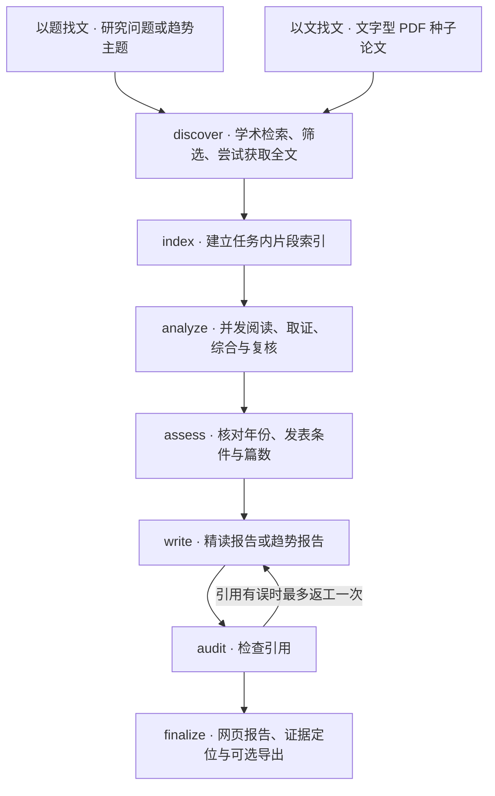

# 研序 · KeYan Deep Research

研序是一个在本机运行的科研文献助手。输入研究问题，可以检索论文、比较方法并形成调研报告。也可以上传 1–3 篇文字型 PDF，从已有论文出发寻找相关工作。报告在浏览器内阅读，引用可以定位到系统收集的证据片段。

## 快速启动

Windows 需要 Python 3.10 或更新版本。在仓库根目录打开 PowerShell：

```powershell
py -3 -m venv .\backend\.venv
.\backend\.venv\Scripts\python.exe -m pip install -r .\backend\requirements-scientific.txt
.\start-scientific.cmd
```

工作台默认监听本机的 8765 端口。第一次可以点击 **先体验合成演示**，用固定输入体验报告和证据定位。启动窗口需要保持打开。

要使用本机已有的 Ollama 模型，在根目录复制配置样例并按需修改：

```powershell
Copy-Item .\.env.scientific.example .\.env.scientific
ollama list
.\start-scientific.cmd
```

样例使用 qwen3.5:4b 生成内容，可用 bge-m3:latest 做向量检索。将 SCIENTIFIC_EMBEDDING_MODEL 设为空可只使用 BM25。在线找论文时需能访问学术索引。配置变更后重启工作台。

## 功能架构



以题精读的自动检索环节使用有界工具循环。模型提出结构化动作，程序校验工具和参数，执行后将结果交回模型。趋势调研与以文找文使用限额检索流程。SQLite 保存任务与进度，恢复从主图入口重新调度并复用已有产物。

打开研究结果后，展开 **查看完整工作流与运行诊断**，可查看编译后图定义、阶段耗时和模型用量。

| 功能 | 源码 |
| --- | --- |
| FastAPI、网页、任务恢复 | [webapp.py](backend/app/scientific_research/webapp.py)、[web/](backend/app/scientific_research/web/)、[store.py](backend/app/scientific_research/store.py) |
| LangGraph 主图、阶段执行与分析子图 | [pipeline.py](backend/app/scientific_research/pipeline.py)、[runner.py](backend/app/scientific_research/runner.py)、[workflow.py](backend/app/scientific_research/workflow.py) |
| 模型选工具、趋势收集、种子论文检索 | [agent_loop.py](backend/app/scientific_research/agent_loop.py)、[trend.py](backend/app/scientific_research/trend.py)、[seed_search.py](backend/app/scientific_research/seed_search.py) |
| 学术索引、任务内 RAG 与证据 | [providers.py](backend/app/scientific_research/providers.py)、[rag.py](backend/app/scientific_research/rag.py)、[evidence.py](backend/app/scientific_research/evidence.py) |
| 角色上下文与跨任务检索线索 | [context_engine.py](backend/app/scientific_research/context_engine.py)、[research_memory.py](backend/app/scientific_research/research_memory.py) |
| 精读和趋势写作、本地诊断与可选 LangSmith | [reporting.py](backend/app/scientific_research/reporting.py)、[branch_report.py](backend/app/scientific_research/branch_report.py)、[observability.py](backend/app/scientific_research/observability.py) |
| 外部客户端只读 MCP | [mcp_server.py](backend/app/scientific_research/mcp_server.py) |

外部学术索引用来发现候选论文，RAG 用于重排已有候选及检索本次任务的证据。历史记忆只作为规划和检索线索。仅有摘要的条目会标明材料范围，论文级别根据可核验的名单及元数据判断。报告供选题与阅读参考，综合判断和实验结论仍由研究者复核。

## 验证与文档

在仓库根目录运行以下功能回归。网页 JavaScript 回归使用本机 Node.js。

```powershell
$env:PYTHONPATH = (Resolve-Path .\backend\app).Path
$env:SCIENTIFIC_EMBEDDING_MODEL = ''
.\backend\.venv\Scripts\python.exe -B -m unittest discover -s .\backend\test_scientific
```

- [使用与配置](SCIENTIFIC_RESEARCH.md) · [两种文献入口](docs/scientific/paper-search-guide.md)
- [真实 LangGraph 图定义](docs/scientific/unified-research-graph.md) · [RAG、恢复和观测](docs/scientific/unified-research-guide.md)
- [工具循环](docs/scientific/tool-loop-module.md) · [研究记忆](docs/scientific/memory-module.md) · [源码学习路线](docs/scientific/2026-11-08-source-study-and-interview.md)
- [回归测试](backend/test_scientific/) · [评测夹具与运行说明](backend/eval/scientific/)
