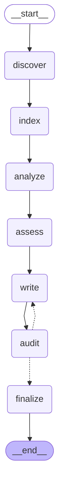

# 当前实际主图

由 pipeline.build_research_graph(...).get_graph().draw_mermaid() 导出，不需要外部图片服务。

analyze 节点调用现有分析子图：read → synthesize → propose → review。

图的状态仅包含任务引用与计数；SQLite 保存原文、分析、报告和阶段进度。恢复从主图入口重新调度并复用成功工件；当前未接入 LangGraph 原生 checkpointer。audit 的返工只检查引用完整性，不是科学结论或语义支持认证。
